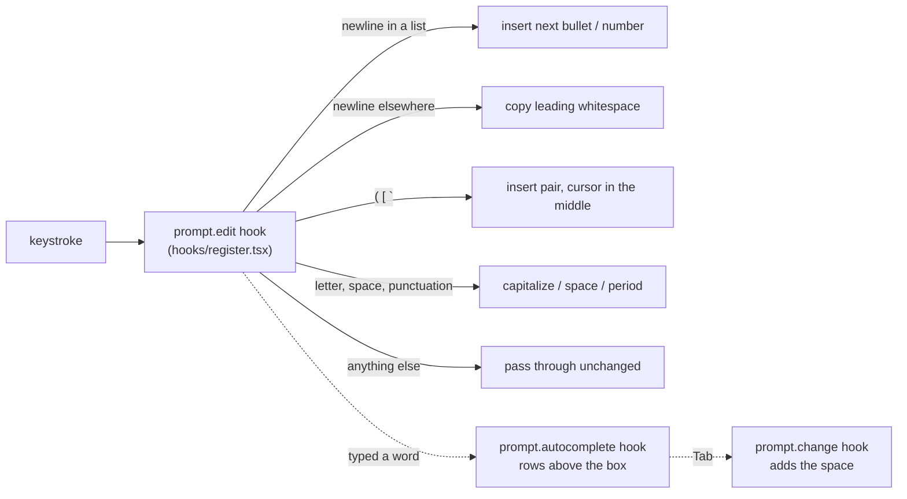

# rich-prompt

**Make Claude Code's prompt box type like a code editor and a phone keyboard.**
Word autocomplete, lists that keep going, auto-indent, auto-pairing and smart punctuation, each one a switch in a settings pane.

<p align="center">
  
</p>

It's a Claude Code **mod**: nothing to run. Once it's installed, the prompt box just behaves better, and `/rich-prompt settings` opens a pane where you pick what is on.

---

## Word autocomplete

Off by default. Turn it on in the settings pane.

While you type a word (3+ letters), up to five completions appear above the prompt box. Your own past words come first, then a bundled list of the 50,000 most common English words.

| You do | You get |
|---|---|
| Type `impl` | `implementation` · `implemented` · `implement` … above the box |
| <kbd>Tab</kbd> | The top row, **plus a space**. If a space already follows, the cursor steps over it |
| <kbd>↓</kbd> / <kbd>↑</kbd> then <kbd>Tab</kbd> | Another row |
| <kbd>Esc</kbd> | Closes the rows and returns to the prompt, text untouched |
| Move with <kbd>←</kbd> <kbd>→</kbd> <kbd>Home</kbd> <kbd>End</kbd> | Nothing: rows only follow typing, so moving through text is never noisy |

- Not offered for `/`, `@`, `!` or `#` tokens, or while the cursor is inside a word.
- Your own words are learned only while the setting is on. They stay on your machine (the mod's local store, top 5,000 words) and are deleted when you turn it off.
- The word list is `hooks/words.txt`, generated by `scripts/build-words.py` from [wordfreq](https://github.com/rspeer/wordfreq) (Robyn Speer) minus the [LDNOOBW](https://github.com/LDNOOBW/List-of-Dirty-Naughty-Obscene-and-Otherwise-Bad-Words) English list. The data file is [CC BY-SA 4.0](https://creativecommons.org/licenses/by-sa/4.0/).

---

## Editor behaviour

On by default.

<p align="center">
  
</p>

| You type | You get | |
|---|---|---|
| `- buy milk` then <kbd>Shift</kbd>+<kbd>Enter</kbd> | `- buy milk`<br>`- │` | 📝 **Bullets continue** (`-`, `*`, `+`) |
| `1. clone` then <kbd>Shift</kbd>+<kbd>Enter</kbd> | `1. clone`<br>`2. │` | 🔢 **Numbers count up** (`a.` `B.` letters too) |
| <kbd>Shift</kbd>+<kbd>Enter</kbd> on an empty `- ` | the empty bullet disappears | 🛑 **Ends the list** |
| <kbd>Space</kbd> <kbd>Space</kbd> right after an empty marker (`1. │`) | `   a. │` | ⇥ **Sub-indent** without Tab: the child marker follows the parent (`1.` → `a.` → `-`, bullets stay bullets) |
| <kbd>Shift</kbd>+<kbd>Enter</kbd> on an empty `    - ` | one level up: `- │` | ⇤ **Outdents** before ending the list |
| <kbd>Backspace</kbd> right after an empty `- ` / `2. ` | nested: back up one level; top level: the marker goes | ⌫ **Marker backspace** |
| new `2. ` inserted in the middle of `1. 2. 3.` | the items below renumber | 🔢 **Renumbers** |
| `    - nested` then <kbd>Shift</kbd>+<kbd>Enter</kbd> | `    - │` | ↳ **Nesting is kept** |
| `  indented` then <kbd>Shift</kbd>+<kbd>Enter</kbd> | `  │` | ⇥ **Auto-indent** keeps leading whitespace |
| `(`  `[`  `` ` `` | `(│)`  `[│]`  `` `│` `` | 🔗 **Auto-pair** |
| `(` `x` then `)` | `(x)│` | ⏭ **Closer steps over** the auto-inserted one, no `(x))` |
| `(` then <kbd>Backspace</kbd> | *(nothing)* | ⌫ **Backspace deletes both** halves of an empty pair |

`│` is the cursor. <kbd>Shift</kbd>+<kbd>Enter</kbd> means whatever key your terminal uses for a newline in the prompt.

Three switches: **Lists**, **Auto-indent**, **Auto-pair**.

### Things it leaves alone

- Two spaces after an empty marker only nest when there is an item to nest under at the same level; otherwise it is a plain space.
- Text inside <code>```</code> code fences never gets list continuation.
- Paste and selections are never auto-paired.
- `` ` `` only pairs at the start of a word, so ``don`t`` stays intact.
- Brackets only pair when the next character is a space, a closing bracket, or the end of the line. Typing `(` in front of a word won't add a stray `)`.

---

## Smart keyboard

Off by default. Mobile-keyboard niceties, each its own switch.

<p align="center">
  
</p>

| You type | You get |
|---|---|
| `h` at the start of the prompt, a new line, a bullet, or after `. ! ?` | `H` (**Capitalize sentences**) |
| `i `, `i'm` | `I `, `I'm` (**Capitalize "i"**) |
| `Well,it` | `Well, it` (**Space after punctuation**, for `, ; ! ?`) |
| `done` <kbd>Space</kbd> <kbd>Space</kbd> | `done. ` (**Double space adds a period**) |
| `well` <kbd>Space</kbd> `,` | `well,` (**No space before punctuation**) |

None of them act inside code fences or `` `inline code` ``, and the spacing rule skips URLs, paths and calls like `f(a,b)`. `.` and `:` never get an automatic space, because of `file.txt`, `3.14` and `a:b`.

---

## Settings

`/rich-prompt settings` opens a side pane with a checkbox per feature. Choices persist across sessions.

| Group | Switch | Default |
|---|---|---|
| Editor | Lists · Auto-indent · Auto-pair | on |
| Smart keyboard | Capitalize sentences · Capitalize "i" · Space after punctuation · Double space adds a period · No space before punctuation · Word autocomplete | off |

---

## Install

Needs **Claude Code 2.1.300 or later**: `prompt.autocomplete` arrived in 2.1.292 and
`prompt.change` in 2.1.300. Mods are on by default. On an older version, rich-prompt shows a
warning at startup and stays off; run `claude update`.

```sh
npx skills add saimageshvar/rich-prompt -g -a claude-code
```

Drop `-g` to install into the current project only.

<details>
<summary>Manual install (clone + symlink)</summary>

```sh
git clone https://github.com/saimageshvar/rich-prompt ~/rich-prompt
ln -s ~/rich-prompt ~/.claude/skills/rich-prompt   # every session, hot-reloaded
```

</details>

Or try it for one session:

```sh
claude --plugin-dir ~/rich-prompt
```

## How it works



Everything lives in [`hooks/register.tsx`](hooks/register.tsx): one `prompt.edit` hook for the editing, one `prompt.autocomplete` hook for the rows, a `prompt.change` hook that notices an accepted row, and a `ui.render` hook for the settings pane.

## Not supported

- **Tab to indent.** The engine keeps Tab for accepting autocomplete rows, so it never reaches the edit hook.
- **Rendered rich text** (bold, headings). The prompt stays plain text.
- **Inline ghost text.** Suggestions are rows above the box, not gray text after the cursor.

## Develop

```sh
claude plugin validate .
claude plugin test .
```

The GIFs are recorded from a live Claude Code session in a Rex pane and rendered in the light theme. [`assets/record.py`](assets/record.py) types each scene one key at a time and snapshots the pane after every key:

```sh
python3 assets/record.py autocomplete autocomplete.cast   # also: editor, smart
agg --theme github-light --font-size 18 autocomplete.cast assets/autocomplete.gif
```

To rebuild the word list: `pip install wordfreq`, download the LDNOOBW `en` file, then `python3 scripts/build-words.py en.txt`.
