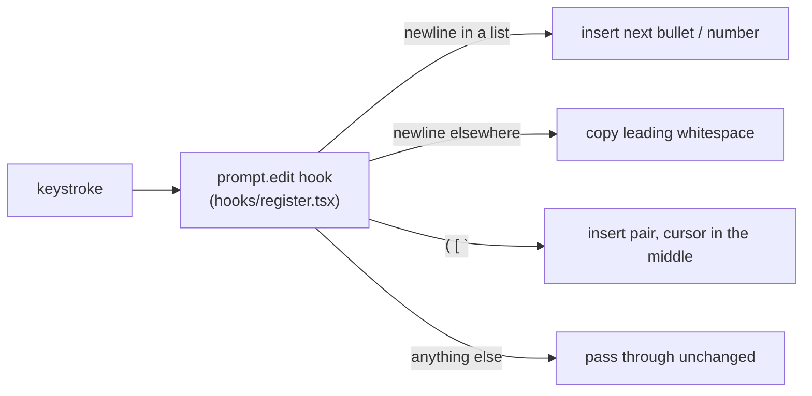

# rich-prompt

**Make Claude Code's prompt box type like a code editor.**
Lists keep going, indentation sticks, and brackets close themselves.

<p align="center">
  
</p>

It's a Claude Code **mod**: nothing to run or invoke. Once it's installed, the prompt box just behaves better.

---

## What it does

| You type | You get | |
|---|---|---|
| `- buy milk` then <kbd>Shift</kbd>+<kbd>Enter</kbd> | `- buy milk`<br>`- │` | 📝 **Bullets continue** (`-`, `*`, `+`) |
| `1. clone` then <kbd>Shift</kbd>+<kbd>Enter</kbd> | `1. clone`<br>`2. │` | 🔢 **Numbers count up** |
| <kbd>Shift</kbd>+<kbd>Enter</kbd> on an empty `- ` | the empty bullet disappears | 🛑 **Ends the list** |
| `    - nested` then <kbd>Shift</kbd>+<kbd>Enter</kbd> | `    - │` | ↳ **Nesting is kept** |
| `  indented` then <kbd>Shift</kbd>+<kbd>Enter</kbd> | `  │` | ⇥ **Auto-indent** keeps leading whitespace |
| `(`  `[`  `` ` `` | `(│)`  `[│]`  `` `│` `` | 🔗 **Auto-pair** |
| `(` then `)` | `()│` | ⏭ **Closer steps over** a fresh pair, no `())` |
| `(` then <kbd>Backspace</kbd> | *(nothing)* | ⌫ **Backspace deletes both** halves of an empty pair |

`│` is the cursor. <kbd>Shift</kbd>+<kbd>Enter</kbd> means whatever key your terminal uses for a newline in the prompt.

### Things it leaves alone

- Text inside <code>```</code> code fences never gets list continuation.
- Paste and selections are never auto-paired.
- `` ` `` only pairs at the start of a word, so ``don`t`` stays intact.
- Brackets only pair when the next character is a space, a closing bracket, or the end of the line. Typing `(` in front of a word won't add a stray `)`.

---

## Install

Needs **Claude Code v2.1.287+**. Mods are on by default.

```sh
git clone https://github.com/saimageshvar/rich-prompt ~/rich-prompt
ln -s ~/rich-prompt ~/.claude/skills/rich-prompt   # every session, hot-reloaded
```

Or try it for one session:

```sh
claude --plugin-dir ~/rich-prompt
```

## How it works



All of it is one small `prompt.edit` hook in [`hooks/register.tsx`](hooks/register.tsx).

## Not supported

- **Tab to indent.** Tab never reaches the edit hook.
- **Rendered rich text** (bold, headings). The prompt stays plain text.

## Develop

```sh
claude plugin validate .
claude plugin test .
```

The demo GIF is recorded from a live Claude Code pane using herdr and [agg](https://github.com/asciinema/agg).
[`assets/record.py`](assets/record.py) types each scene one key at a time and snapshots the pane after every key:

```sh
python3 assets/record.py <herdr-pane-id> demo.cast   # pane running `claude --plugin-dir .`
agg --font-size 18 --theme monokai demo.cast assets/demo.gif
```
